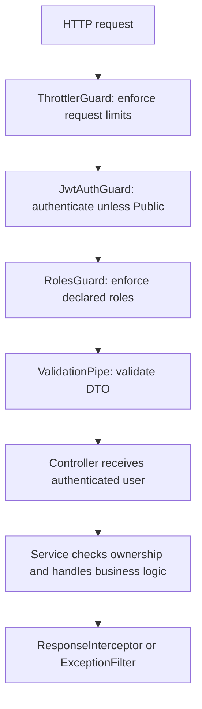

# Authentication and Authorization — Booking API

## 1. Scope and Requirements

This feature extends the NestJS source from course 4 with authentication, authorization, and resource access control. It preserves the project's in-memory storage without adding a database, keeping the implementation focused on the assignment's security requirements.

| Requirement | Implementation |
| --- | --- |
| Authentication | Email/password registration and login; request authentication through Passport JWT |
| Stateless authentication | Signed, expiring Bearer access tokens without server-side login sessions |
| Authorization | `user`/`admin` roles combined with booking/review ownership checks |
| API access control | Global guards requiring authentication by default; explicitly marked public endpoints |
| Security and REST | Password hashing, DTO validation, appropriate status codes, rate limiting, and security headers |
| Review deliverables | Source code, HTTP tests, a Postman collection, and this document |

## 2. Solution Choices and Rationale

### NestJS, Passport, and JWT

The implementation retains NestJS/TypeScript and the existing architecture, using the framework's dependency injection and modules. `@nestjs/passport` and `passport-jwt` extract Bearer tokens and verify JWTs; `@nestjs/jwt` signs tokens. Cryptographic algorithms are provided by libraries rather than implemented manually.

JWT meets the stateless authentication requirement: each request carries a token in the `Authorization` header, and the server verifies its signature and claims instead of looking up a login session. Clients do not need to resend their passwords for each business API request.

This is application-specific JWT authentication. It does not implement OAuth 2.0 or OpenID Connect.

### RBAC Combined with Ownership

Role-based access control (RBAC) distinguishes `user` and `admin`, supporting administrative APIs such as the account list. For bookings and reviews, role checks alone are insufficient: two accounts with the `user` role must not modify each other's resources. Services therefore also check `ownerId`.

The shared rule allows access when the authenticated user is the resource owner **or** has the `admin` role.

### Bcrypt and In-Memory Storage

Bcrypt uses a cost factor of 12, with salts managed by the library. User records store `passwordHash`, not the original password. Passwords are limited to 72 bytes to avoid bcrypt ignoring bytes beyond its input limit. Registration requires at least eight characters.

In-memory storage matches the demonstration scope and original source. Stateless authentication does not mean that the server stores no business data: users, bookings, and reviews are stored, but login sessions are not.

## 3. Structure and Responsibilities

| Component | Responsibility |
| --- | --- |
| `src/auth/auth.controller.ts` | Registration, login, and `/me` endpoints |
| `src/auth/auth.service.ts` | Password hashing/comparison and access token issuance |
| `src/auth/strategies/jwt.strategy.ts` | JWT verification and current-user resolution |
| `src/auth/guards/jwt-auth.guard.ts` | Authentication enforcement, except on `@Public()` routes |
| `src/auth/guards/roles.guard.ts` | Role checks declared through `@Roles()` |
| `src/auth/decorators/` | `@Public()`, `@Roles()`, and `@CurrentUser()` |
| `src/auth/resource-access.ts` | Shared owner-or-admin authorization helper |
| `src/users/` | User storage, configuration-based admin initialization, and account administration |
| `src/bookings/` | Booking ownership, scoped lists, and access control |
| `src/reviews/` | Public reads and authorized creation, updates, and deletion |
| `src/config/environment.ts` | Secret and port validation at startup |
| `src/setup-app.ts` | ValidationPipe, Helmet, and cache prevention |
| `test/security.test.cjs` | HTTP tests against a real NestJS application |

Guards are registered globally through `APP_GUARD`. The main request flow is:



`@Public()` bypasses JWT authentication only. Rate limiting and DTO validation still apply. Ownership checks reside in services so that authorization occurs before a resource is read or changed.

## 4. How It Works

### 4.1. Registration

1. The client sends an email and password to `POST /api/v1/auth/register`.
2. The DTO trims and lowercases the email, then validates its format and input limits.
3. `AuthService` hashes the password with bcrypt.
4. `UsersService.create()` checks for duplicate emails when inserting the user, including when concurrent requests have both been waiting for hashing to finish.
5. The server generates a UUID and assigns the `user` role; clients cannot select a role.
6. The server returns `201` with selected public account fields, excluding the password and password hash. A duplicate email returns `409`.

Registration does not issue a token automatically. The client logs in after creating the account.

### 4.2. Login

1. The client sends an email and password to `POST /api/v1/auth/login`.
2. The server looks up the user and performs a bcrypt comparison. For an unknown email, it still compares against a dummy hash to reduce timing differences; this does not guarantee the complete elimination of timing side channels.
3. Unknown emails and incorrect passwords both return `401` with the same message.
4. Valid credentials result in a signed JWT and a `200` response.

The successful response data is:

```json
{
  "access_token": "<JWT issued by the server>",
  "token_type": "Bearer",
  "expires_in": 900
}
```

These fields are inside the response envelope's `data` property.

### 4.3. JWT and Subsequent Requests

| Property | Value or Rule |
| --- | --- |
| Algorithm | `HS256`; the strategy accepts only this algorithm |
| Secret | Environment variable `JWT_SECRET`, at least 32 bytes after trimming; generate it randomly |
| Lifetime | 900 seconds, or 15 minutes |
| `sub` | User ID |
| `role` | Role at issuance; authorization uses the current user's stored role |
| `iss` | `booking-api` |
| `aud` | `booking-api-client` |
| `iat`, `exp` | Issued-at and expiration timestamps |

The client sends:

```http
Authorization: Bearer <access_token>
```

The strategy verifies the signature, algorithm, expiration, issuer, and audience. It also checks that `sub`, `iat`, and `exp` are present with the expected types. It then resolves the in-memory user and places `id`, `email`, and `role` in `request.user`. `@CurrentUser()` supplies these values to controllers.

Looking up a user does not create a session: there is no login record or session ID. The token's role is not the final source of authority. Even a token containing a false `admin` role cannot elevate a user whose current stored role is `user`.

JWT contents are signed, not encrypted. Passwords and password hashes are never included. Decoding a JWT on the client does not verify its signature.

### 4.4. Resource Ownership

When creating a booking or review, the server assigns `ownerId` from the authenticated `user.id`. `customerName` and `authorName` are display names, not proof of ownership.

DTOs do not allow clients to set `ownerId`, `role`, `id`, or arbitrary status values. PUT and PATCH assign only explicitly allowed business fields. Request bodies are not spread directly into resource objects.

Accessing another user's booking returns `403` for reads, replacements, updates, and deletion. Reviews are publicly readable, but only their owner or an admin may update or delete them. Unknown IDs return `404`. Distinguishing `403` from `404` can reveal that a resource exists; this is an explicit choice for the demonstration.

### 4.5. Admin Initialization

When both `ADMIN_EMAIL` and `ADMIN_PASSWORD` are configured, the server creates an administrator at startup and hashes the password before storing the account in memory. Providing only one variable or invalid credentials causes startup to fail. Leaving both empty disables admin initialization.

There is no public role-elevation endpoint. `GET /api/v1/users` uses `@Roles(Role.ADMIN)` and returns selected account fields without password hashes. Admins log in through the same login endpoint as ordinary users.

## 5. API Access Matrix

All paths below use the `/api/v1` prefix.

| Method | Path | Unauthenticated Client | User | Admin |
| --- | --- | --- | --- | --- |
| POST | `/auth/register` | Allowed | Allowed | Allowed |
| POST | `/auth/login` | Allowed | Allowed | Allowed |
| GET | `/auth/me` | 401 | Own profile | Own profile |
| GET | `/services` | Allowed | Allowed | Allowed |
| GET | `/services/:id` | Allowed | Allowed | Allowed |
| GET | `/bookings` | 401 | Own bookings only | All bookings |
| POST | `/bookings` | 401 | Create own booking | Create own booking |
| GET | `/bookings/:id` | 401 | Own booking only | Any booking |
| PUT/PATCH/DELETE | `/bookings/:id` | 401 | Own booking only | Any booking |
| GET | `/services/:serviceId/reviews` | Allowed | Allowed | Allowed |
| GET | `/reviews` | Allowed | Allowed | Allowed |
| GET | `/reviews/:id` | Allowed | Allowed | Allowed |
| POST | `/services/:serviceId/reviews` | 401 | Create own review | Create own review |
| PUT/PATCH/DELETE | `/reviews/:id` | 401 | Own review only | Any review |
| GET | `/users` | 401 | 403 | Allowed |

## 6. Validation, Security, and REST Behavior

- DTOs are decorated classes so `ValidationPipe` can validate them at runtime. Unknown properties are rejected, and rating strings are not automatically converted into numbers.
- Bookings require a valid calendar date in `YYYY-MM-DD` format, a time in `HH:mm` format from `00:00` to `23:59`, an existing service, and a nonblank customer name of at most 100 characters.
- Reviews require a nonblank author name of at most 100 characters, an integer rating from 1 to 5, and a comment of at most 2,000 characters. POST may omit the comment; PUT requires all writable fields; PATCH updates only supplied fields.
- Empty PATCH requests return `400`; `null` is not treated as an omitted value. An empty comment string (`""`) is allowed to clear a comment. Checking `value !== undefined` prevents initialized DTO class fields from being mistaken for client-supplied fields.
- The default rate limit is 120 requests per 60 seconds, per IP and handler. Registration and login each have a limit of 10 requests per 60 seconds. Exceeding a limit returns `429` with `Retry-After`. This is not a single account-wide allowance across all endpoints.
- Helmet adds security headers. Responses passing through the cache middleware receive `Cache-Control: no-store`.
- JSON bodies are limited to 16 KB; oversized bodies return `413`.
- `401` responses include `WWW-Authenticate: Bearer`. Unexpected error responses do not expose stack traces.
- `.env` is ignored by Git. `.env.example` lists configuration variables without real secrets.
- Deployment beyond localhost must use HTTPS on the server or reverse proxy. This application does not provision TLS certificates.

| Status | Meaning in This Project |
| --- | --- |
| 200 | Successful read, update, or login |
| 201 | Successful account, booking, or review creation |
| 204 | Successful deletion with no response body |
| 400 | Invalid input, unknown DTO properties, or an empty PATCH |
| 401 | Missing, invalid, or expired token; or failed login |
| 403 | Authenticated user lacks the required role or ownership |
| 404 | Service, booking, or review does not exist |
| 409 | Email already registered |
| 413 | JSON body too large |
| 429 | Request limit exceeded |
| 500 | Unexpected internal error |

Success responses contain `success`, `statusCode`, `data`, and `timestamp`. Error responses contain `success`, `statusCode`, `message`, `errors`, `path`, and `timestamp`. Successful DELETE responses have no envelope because HTTP 204 has no body.

## 7. Installation and Startup

Verified environment: Node.js `v26.13.0`. The start script uses Node's `--env-file-if-exists` option.

From the repository root:

```bash
npm ci
```

Only if `.env` does not already exist, copy the template. Do not overwrite an existing configuration file:

```bash
cp .env.example .env
openssl rand -hex 32
```

Paste the generated random value into `JWT_SECRET` in `.env`. Do not hardcode a JWT secret in the source. Available settings:

```env
JWT_SECRET=
PORT=3000
ADMIN_EMAIL=
ADMIN_PASSWORD=
```

`JWT_SECRET` must have a valid value before startup. To test admin access, set a dedicated email and a password of at least eight characters and at most 72 bytes in the admin variables. Do not commit or include real credentials in a PR.

```bash
npm start
```

The default server URL is `http://localhost:3000`. Stop an older server first to avoid a port conflict. `npm start` always builds the current TypeScript source before launching the server. A failed build stops startup instead of running stale output. `npm run start:dev` delegates to the same command and does not watch files automatically. This startup path requires build dependencies, so install with `npm ci` without omitting devDependencies.

`noEmitOnError` prevents new JavaScript output when TypeScript compilation fails. Files under `dist` were already tracked in the original repository and may still appear in Git diffs even though `dist/` is now ignored. Review source changes in `src`; build regenerates their JavaScript output.

## 8. Testing and Reproduction

### 8.1. Automated Tests

```bash
npm test
```

The script compiles TypeScript before running Node's test runner. Tests create a real NestJS application on an ephemeral port and send HTTP requests through the same modules, guards, validation, and middleware as the main application. The test process creates its own secret, admin, and sample users. It does not modify `.env` or stop the reviewer's running server.

Verified on November 19, 2026 (Asia/Bangkok): **27 tests reported by Node's runner, 27 passed, 0 failed**. This includes 21 HTTP subtests, three startup-path subtests, their two parent tests, and one separate configuration test; it does not represent 27 independent HTTP scenarios.

Verified areas:

| Area | Coverage |
| --- | --- |
| Public APIs | Service/review reads without tokens; missing resources |
| Accounts | Email normalization, password hashing, no hash disclosure, duplicates, concurrent registration |
| Privilege escalation | Client-supplied role/ownerId rejected; token role cannot override the current stored role |
| JWT | Login, `/me`, missing/invalid tokens, expiration, incorrect signature/audience, missing exp, unknown users |
| RBAC | Ordinary users denied account-list access; admins allowed |
| Bookings | Authentication for every method, server-assigned ownership, scoped lists, user B denied access to user A's resources, admin access |
| Reviews | Public reads, authenticated writes, owner/admin update and deletion |
| DTO/PATCH | Invalid dates/times/ratings, null values, unknown properties, empty PATCH, valid empty comments |
| HTTP | Empty 204 deletion responses, malformed JSON 400, oversized body 413, authentication and security headers |
| Rate limiting | Excessive login attempts return 429 and Retry-After |
| Configuration | Missing/short secret and invalid port rejected by validation |
| Startup path | Clean dependency installation, stale/missing dist, unauthenticated booking access, and build-failure fallback prevention |

The startup-path regression test installs dependencies with `npm ci` in an isolated directory containing the current source/configuration and the tracked `dist` artifact from `HEAD`. It calls `npm start` directly without an explicit build, checks that all booking methods reject unauthenticated requests, then repeats with no `dist` directory. It also introduces a compilation error and verifies startup fails without falling back to existing JavaScript. Temporary fixtures use their own secrets and ports.

These checks do not replace penetration testing or load testing. Passing tests do not establish that every possible application path is free of defects.

## 9. Limitations and Future Improvements

- Users, bookings, reviews, and rate-limit counters exist only within the process. Restarting clears them; an admin is recreated from configuration when enabled. Newly generated user IDs make tokens issued for previous users unusable even before their expiration.
- Multiple instances do not share application data or rate limits. Scaling requires shared storage; a database is outside the scope of this demonstration.
- There are no refresh tokens, logout endpoint, JWT revocation list, or password change/reset endpoints. A valid token remains usable until expiration while its user exists. Removing a token from one client does not revoke other copies.
- HS256 uses a shared signing/verification secret in this single application. Key rotation and asymmetric verification across multiple services are not implemented.
- Duplicate registration returns 409, which can disclose whether an email is registered. This behavior is retained to demonstrate REST conflict handling. Login failure messages remain uniform.
- Reviews are public, including display names and ownerId; they do not expose email or passwordHash. Moderation, per-account spam prevention, and a one-review-per-user-per-service policy are not implemented.
- Email verification, administrative audit logging, pagination, and data retention policies are not implemented. IP-based limits can affect users sharing an IP address. Deployment behind a proxy requires correctly configured trusted proxies.
- Date validation checks formatting and calendar validity only. Future-date requirements, time-slot conflicts, and capacity rules are business features outside this authentication/authorization scope.

## 10. Final Reviewer Checklist

- [ ] The access matrix matches the assignment requirements.
- [ ] No endpoint lets a client grant itself admin privileges or transfer resource ownership.
- [ ] Users A/B and the admin behave as expected for bookings and reviews.
- [ ] `npm test` succeeds and its results have been inspected.
- [ ] The in-memory storage, 15-minute token lifetime, and lack of individual token revocation are understood and accepted.
- [ ] The PR contains no `.env`, real secrets, tokens, or passwords.

The documentation and test results support the review. Final approval belongs to the reviewer.

## 11. References

- [NestJS Authentication](https://docs.nestjs.com/security/authentication)
- [NestJS Passport](https://docs.nestjs.com/recipes/passport)
- [NestJS Authorization](https://docs.nestjs.com/security/authorization)
- [NestJS Validation](https://docs.nestjs.com/techniques/validation)
- [NestJS Rate Limiting](https://docs.nestjs.com/security/rate-limiting)
- [NestJS Security Headers](https://docs.nestjs.com/security/helmet)
