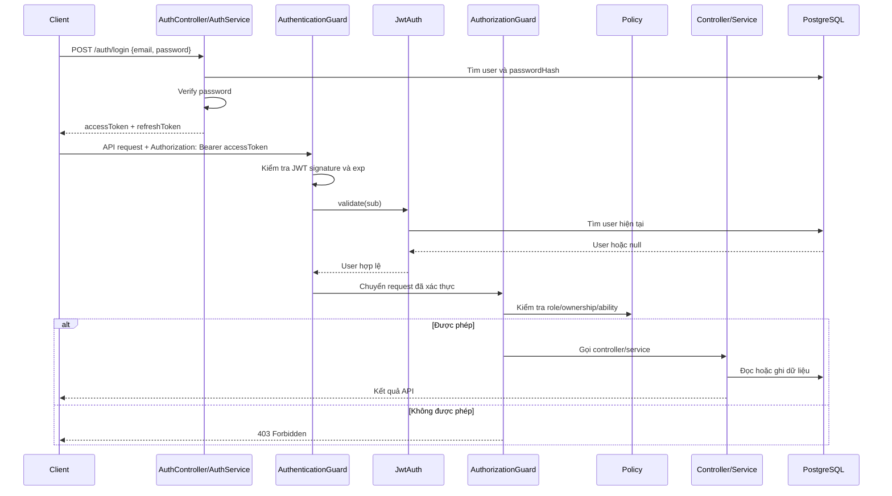

# Giải pháp Authentication & Authorization

## 1. Tổng quan và phạm vi

Hệ thống bổ sung hai lớp bảo vệ cho API:

- Authentication: xác thực user bằng access token JWT gửi qua `Authorization: Bearer ...`.
- Authorization: kiểm tra role và ownership bằng `@Can(...)` cùng các policy.

Access token mang thông tin xác thực nên phần kiểm tra chữ ký và thời hạn không cần session server. Tuy nhiên refresh token vẫn được lưu trong storage in-memory để hỗ trợ rotation, logout và phát hiện token bị dùng lại. Vì vậy access request có tính stateless, còn toàn bộ cơ chế token không stateless tuyệt đối.

Phạm vi hiện tại gồm đăng ký, đăng nhập, refresh/logout, user, service, booking và review.

## 2. Lựa chọn giải pháp và lý do

### JWT Bearer cho access token

JWT phù hợp với API vì client gửi token độc lập trong từng request; server không cần tạo session riêng cho mỗi access request. Token được ký bằng secret `JWT_ACCESS_KEY` từ biến môi trường, có thời hạn mặc định 15 phút (`JWT_ACCESS_TTL`). Với secret dạng chuỗi, thư viện `@nestjs/authentication` sử dụng thuật toán HMAC `HS256`.

Cách gửi token hiện tại:

```http
Authorization: Bearer <accessToken>
```

Cookie hoặc session cookie không được cấu hình.

### Refresh token

Login cấp access token và refresh token. Refresh token do thư viện tạo dưới dạng chuỗi ngẫu nhiên 32 bytes, tương đương 256 bit, và được lưu theo giá trị băm trong refresh-token storage. TTL mặc định là 7 ngày (`JWT_REFRESH_TTL`).

Mỗi refresh token chỉ được dùng một lần. Khi refresh thành công, token cũ được đánh dấu đã dùng và token mới được cấp. Nếu token cũ bị dùng lại, thư viện thu hồi cả token family. Storage hiện được bật in-memory qua `allowInMemoryStorage: true`.

### Hash password

Password không được lưu trực tiếp. `PasswordHasher` của `@nestjs/authentication` hash password trước khi lưu và verify password khi login. Cột `passwordHash` được đánh dấu `select: false`, nên các truy vấn user thông thường không lấy cột này.

## 3. Cơ chế hoạt động



Request không có hoặc có JWT không hợp lệ bị authentication guard từ chối, thông thường với `401 Unauthorized`. `@Public()` bỏ qua authentication và authorization; `@Can.Anyone()` chỉ bỏ qua kiểm tra ability nhưng vẫn yêu cầu đăng nhập.

## 4. Bảng phân quyền API

| Method | Endpoint | Truy cập | Ghi chú |
|---|---|---|---|
| GET | `/` | Public | Health/hello response. |
| POST | `/auth/register` | Public | Tạo user role `user`, hash password. |
| POST | `/auth/login` | Public | Trả access token và refresh token. |
| POST | `/auth/refresh` | Public | Dùng refresh token; token cũ bị rotation. |
| POST | `/auth/logout` | Public | Thu hồi refresh-token family của token gửi lên. |
| GET | `/auth/me` | Authenticated | User đã đăng nhập; trả dữ liệu public, không trả `passwordHash`. |
| GET | `/services` | Authenticated | `@Can.Anyone()`; không public thật sự. |
| GET | `/services/:id` | Authenticated | `@Can.Anyone()`; service phải tồn tại. |
| GET | `/services/:serviceId/reviews` | Public | Kiểm tra service tồn tại rồi trả review. |
| POST | `/services/:serviceId/reviews` | Authenticated | Cần booking `COMPLETED` của user cho service; mỗi user/service chỉ một review. |
| GET | `/reviews/:id` | Public | Review phải tồn tại. |
| PUT | `/reviews/:id` | Owner hoặc `admin` | Owner được xác định từ `review.userId`; admin được policy bypass. |
| PATCH | `/reviews/:id` | Owner hoặc `admin` | Kiểm tra ownership trong `ReviewPolicy`. |
| DELETE | `/reviews/:id` | Owner hoặc `admin` | Kiểm tra ownership trong `ReviewPolicy`. |
| GET | `/bookings` | `admin` | `BookingPolicy.viewAll`; admin được bypass qua `before()`. |
| GET | `/bookings/me` | Authenticated | Chỉ lấy booking của user hiện tại. |
| GET | `/bookings/:id` | Owner hoặc `admin` | Owner phải trùng `booking.userId`. |
| POST | `/bookings` | Authenticated | Booking mới luôn có status `PENDING`, userId lấy từ token. |
| PUT | `/bookings/:id` | Owner khi `PENDING` hoặc `admin` | Policy kiểm tra ownership và status. |
| PATCH | `/bookings/:id` | Owner khi `PENDING` hoặc `admin` | Chỉ sửa `serviceId`, `date`, `timeSlot`. |
| DELETE | `/bookings/:id` | Owner khi `PENDING` hoặc `admin` | Policy kiểm tra ownership và status. |
| GET | `/users` | `admin` | Liệt kê user public. |
| GET | `/users/:id` | Chính user đó hoặc `admin` | Policy so sánh `user.id` với route ID. |
| PATCH | `/users/:id` | Chính user đó hoặc `admin` | Chỉ sửa name/email. |
| DELETE | `/users/:id` | `admin`, trừ chính mình | Controller chặn admin tự xoá tài khoản. |

Không có `POST /users`; user mới phải đi qua `/auth/register` để có password hash.

## 5. Mô hình phân quyền

### Role

Code hiện có hai role:

- `user`: có thể xem/sửa tài nguyên của mình theo policy, tạo booking và tạo review nếu đủ điều kiện.
- `admin`: `before()` trong các policy cho phép bypass ability; có thể xem toàn bộ booking, quản lý user và sửa/xoá review hoặc booking của user khác.

### Tầng kiểm soát

- Cấu hình chung: `AuthenticationModule.forRootAsync()` và `AuthorizationModule.forRoot()` được đăng ký global trong `AppModule`.
- Route: decorator `@Public()`, `@Can(...)` và `@Can.Anyone()` khai báo yêu cầu của endpoint.
- Policy: `UserPolicy`, `BookingPolicy` và `ReviewPolicy` quyết định role/ownership/status.
- Service: kiểm tra dữ liệu nghiệp vụ như service tồn tại, booking `COMPLETED`, review trùng và validation input.
- Database: unique email của user và unique `(userId, serviceId)` của review.

## 6. Nguyên tắc bảo mật và REST đã áp dụng

- Password được hash, không lưu plaintext.
- `passwordHash` không được select mặc định.
- User response được chuyển thành public user; `/auth/me` cũng loại bỏ password hash.
- JWT secret, TTL và database connection được đọc từ environment/config.
- Login sai email hoặc password trả thông báo chung `Invalid email or password`, không tiết lộ email nào tồn tại.
- Access token có thời hạn; refresh token có TTL, rotation và revoke family.
- User bị xoá sẽ không còn được `JwtAuth.validate()` chấp nhận ở request sau.
- Các resource ownership được kiểm tra bằng user hiện tại, không lấy userId từ body khi tạo booking/review.
- Các operation tạo/sửa/xoá dùng HTTP method phù hợp; logout/delete trả `204` khi thành công.
- Input auth, user, booking và review có một phần validation thủ công trong service, gồm độ dài name/password, format email ở một số flow, ngày booking, rating và comment.
- Lỗi xác thực và phân quyền được phân biệt theo guard: authentication là `401`, authorization là `403`.

## 7. Trường hợp biên và hạn chế đã biết

- Refresh token storage đang là in-memory. Restart app làm mất refresh token; nhiều instance không chia sẻ token state.
- Không có rate limit cho register, login hoặc refresh. Endpoint refresh không bị giới hạn một phút một lần; token có entropy 256 bit và single-use rotation.
- Chưa có chức năng quên mật khẩu, reset password hoặc đổi password.
- Không có MFA, email verification hoặc account lockout.
- Chưa có endpoint đổi status booking. Vì vậy booking tạo qua API bắt đầu ở `PENDING`; muốn tạo review cần dữ liệu booking `COMPLETED` có sẵn hoặc cập nhật trực tiếp trong database.
- Update/delete booking kiểm tra status trong policy trước khi service ghi dữ liệu, nhưng repository chưa dùng điều kiện status trong một câu lệnh update/delete nguyên tử. Có thể có race condition.
- `BookingPolicy` và `ReviewPolicy` đọc record trong policy trước khi service đọc lại record, nên có thể phát sinh nhiều lần đọc database.
- Một số decorator chuyển route ID bằng `Number(...)` trước `ParseIntPipe`; ID không hợp lệ có thể đi qua policy với `NaN` trước khi pipe xử lý.
- Validation chưa dùng global `ValidationPipe`; DTO chỉ là type TypeScript. Đăng ký có trim/lowercase và kiểm tra độ dài name/password, nhưng chưa kiểm tra format email trước khi tạo user.
- `DB_SYNCHRONIZE` mặc định tắt, nên schema phụ thuộc migration.
- `allowInMemoryStorage` đang hardcode `true`; chưa có persistent refresh-token store.
- Không có cấu hình CORS, security headers hoặc audit logging riêng trong source hiện tại.
- Không có flow tự khởi tạo admin; role admin phải được tạo/cập nhật ngoài các endpoint public hiện có.

## 8. Test nhanh bằng curl

Đặt biến môi trường shell:

```bash
BASE=http://localhost:3000
EMAIL="tester$(date +%s)@example.com"
```

Đăng ký và đăng nhập:

```bash
curl -s -X POST "$BASE/auth/register" \
  -H 'Content-Type: application/json' \
  -d "{\"name\":\"Test User\",\"email\":\"$EMAIL\",\"password\":\"Password123!\"}"

curl -s -X POST "$BASE/auth/login" \
  -H 'Content-Type: application/json' \
  -d "{\"email\":\"$EMAIL\",\"password\":\"Password123!\"}"
```

Lưu `accessToken` từ response login vào biến `TOKEN`, rồi gọi API có token:

```bash
TOKEN='<accessToken từ response login>'
curl -i "$BASE/auth/me" \
  -H "Authorization: Bearer $TOKEN"

curl -i "$BASE/bookings/me" \
  -H "Authorization: Bearer $TOKEN"
```

Gọi API thiếu token:

```bash
curl -i "$BASE/auth/me"
```

Kết quả dự kiến là `401 Unauthorized`.

Gọi API cần quyền admin bằng token user thường:

```bash
curl -i "$BASE/bookings" \
  -H "Authorization: Bearer $TOKEN"
```

Kết quả dự kiến là `403 Forbidden`.

